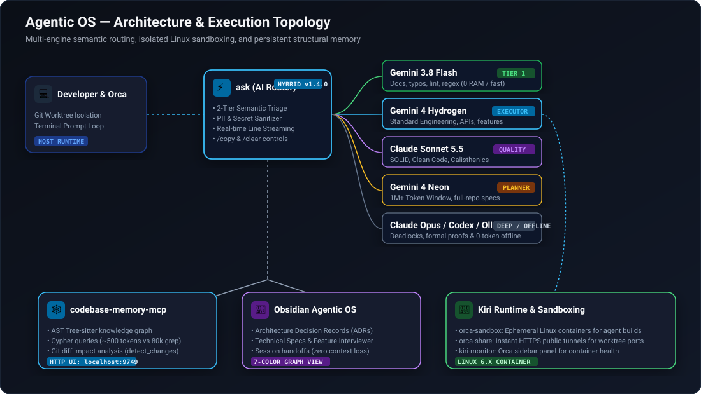

# Developer Environment & Agentic Engineering Workspace

This repository contains my personal macOS development environment and the operational tooling I use daily for **Agentic AI Engineering**, **Multi-Agent Orchestration**, and **Local Virtualization**.

Rather than treating AI as a conversational novelty or an autocomplete plugin, this setup treats LLMs as specialized execution engines within a disciplined Unix workflow: strict context boundaries, AST-based knowledge graphs, semantic model routing, containerized sandboxing, and persistent architectural memory.

<p align="center">
  
</p>

---

## Architecture & Daily Engineering Patterns

### 1. Semantic Model Routing (`bin/ask`)
Different software tasks require radically different reasoning depth and token economics. Sending a typo fix to an expensive reasoning model is wasteful; asking a fast small model to debug an asynchronous race condition leads to hallucinations.

The custom CLI router (`ask`) intercepts developer intent and routes the task to the right tier:

- **Tier 1 — Fast & Documentation (`Gemini 3.8 Flash`):** READMEs, commit messages, documentation, regex validation, and small utility snippets. Runs with minimal latency and zero local RAM footprint.
- **Tier 2 — High-Throughput Implementation (`Gemini 4 Hydrogen`):** Daily feature implementation, endpoints, controllers, and unit tests. Tuned for speed and surgical code output without verbose conversational filler.
- **Tier 3 — Clean Architecture & Calisthenics (`Claude Sonnet 5.5`):** Refactoring, enforcing SOLID principles, eliminating deep nesting (Object Calisthenics guard), and domain modeling.
- **Tier 4 — Architectural Planning & Large Repositories (`Gemini 4 Neon`):** Full-codebase audits, technical specifications (RFCs/ADRs), and deep context analysis leveraging a 1M+ token window.
- **Tier 5 — Deep Reasoning & Concurrency (`Claude Opus 5.5` / `Codex`):** Distributed system failures, memory leaks, thread contention, and formal algorithmic proofs.
- **Offline Fallback (`Ollama / qwen3.5:9b`):** When operating disconnected or when cloud quotas trigger a 429 rate limit, requests seamlessly cascade to local compute without interrupting the terminal session.

The router features unbuffered line-by-line streaming, native macOS clipboard integration (`/copy`), context management (`/clear`), and dynamic configuration via `config/ask-config.json`.

---

### 2. AST Knowledge Graph over Naive RAG (`codebase-memory-mcp`)
Vector search (RAG) fails on codebases because code is a graph of relationships, not a collection of text documents. Grep is similarly inefficient, frequently costing 80,000+ tokens just to locate function callers across an unfamiliar repo.

I use a persistent, AST-based Model Context Protocol server (`codebase-memory-mcp`) integrated across all active coding agents (Antigravity, Claude Code, Codex, and Cursor):

- Parses code with Tree-sitter into an indexed graph of nodes (`Function`, `Class`, `Route`, `Interface`) and edges (`CALLS`, `IMPORTS`, `DEFINES`, `HANDLES`).
- Resolves structural questions ("Who calls this service?", "What functions depend on this interface?") in under 500 tokens using Cypher queries.
- Runs change-impact analysis (`detect_changes()`) directly against git diffs to map exactly which symbols are affected before committing.
- Includes a live web visualization interface running on `http://localhost:9749`.

---

### 3. Agent Sandboxing & Instant Previews (Orca + Kiri)
Autonomous agents can be dangerous when allowed to execute arbitrary scripts directly on the host system. Furthermore, multi-agent workflows require isolated environments for branch testing.

I combine Orca (workspace and worktree manager) with Kiri (a lightweight native Linux container and VM engine for macOS):

- **Isolated Execution (`bin/orca-sandbox`):** Mounts the current Orca worktree into an isolated, ephemeral Linux container. Automatically detects the stack (Node, Python, Go, Rust) and executes builds or tests without polluting the macOS host.
- **Instant Previews (`bin/orca-share`):** Exposes local development ports (e.g., `3000`, `8080`) through an encrypted HTTPS public tunnel with a single command. Allows immediate testing of agent-generated UI on external devices.
- **Orca Sidebar Monitor (`orca-plugins/kiri-monitor`):** Native right-panel plugin for Orca displaying container health, Docker socket status, and active network shares.

---

### 4. Persistent Memory & ADRs (`Obsidian Agentic OS`)
AI agents lose all memory once a terminal session closes. To maintain long-term architectural continuity across weeks of work:

- Specifications, Architecture Decision Records (ADRs), and Session Handoffs are stored in an Obsidian vault (`~/obsidian/Agentic OS`).
- Agents read prior context via the `obsidian-memory` skill before beginning a refactor.
- When an agent completes a milestone or pauses work, it writes a structured session summary (`04_SESSIONS/SES_YYYY-MM-DD_<Slug>.md`), documenting decisions, touched files, and open risks for the next session.

---

### 5. Automated Git Quality & Bloat Guards (`git-hooks/pre-commit`)
Clean engineering starts before code reaches remote branches. A global pre-commit hook enforces standards across every repository on the machine:

- **Binary & Large File Blocker:** Rejects accidental staging of files larger than 5MB (dumps, large datasets, build artifacts) and prompts for Git LFS.
- **Calisthenics & Complexity Guard:** Scans staged code files for excessive indentation (>= 4 levels) and warns about deeply nested logic, encouraging early returns and guard clauses.
- **Dependency Sanity:** Runs automated unused-dependency checks (`depcheck`) whenever `package.json` changes and flags unpinned versions in `requirements.txt`.
- **Global macOS Hygiene:** Prevents `.DS_Store`, `._*`, and local IDE state from polluting repositories via a unified `.gitignore_global`.

---

## Agent Skills Catalog — What They Do and Why They Exist

Skills are specialized instruction sets and procedural toolchains injected into agent runtimes (Antigravity, Claude Code, and Codex). Rather than relying on generic LLM pre-training, each skill constrains the agent to battle-tested patterns, avoiding common AI traps like assumption debt, hallucinated APIs, or premature over-engineering.

### 1. Software Craftsmanship & Architecture Gates

- **`feature-interviewer`**  
  *What it does:* Conducts a structured requirement-gathering interview before any code is written, asking targeted questions about acceptance criteria, failure boundaries, affected services, and non-goals.  
  *Why it exists:* LLMs fail most frequently when they guess missing requirements. This skill kills assumption debt by freezing scope and aligning on technical trade-offs before touching a single file.

- **`yagni-kiss-sine`**  
  *What it does:* Enforces YAGNI (You Aren't Gonna Need It), KISS, SINE (Simple Is Nearly Everything), and Pragmatic Object Calisthenics (max 1–2 indentation levels, early returns, zero `else`, single-dot Law of Demeter).  
  *Why it exists:* LLMs love generating speculative abstractions, single-implementation interfaces, and deeply nested conditionals. This skill acts as an architectural circuit breaker, forcing simple, flat, deletion-oriented code.

- **`codebase-memory`**  
  *What it does:* Interacts with the local AST knowledge graph (`codebase-memory-mcp`) to perform Cypher queries, trace call paths, audit dead code, and measure fan-in/fan-out metrics.  
  *Why it exists:* Eliminates brute-force grep bills (saving ~80,000 tokens per investigation) and allows agents to determine the exact blast radius of a change before modifying an interface.

- **`system-design` & `ddia-systems`**  
  *What it does:* Guides distributed system architecture based on Designing Data-Intensive Applications principles: partition strategies, replication lag handling, transaction boundaries, idempotent consumer patterns, and consensus.  
  *Why it exists:* Prevents agents from producing naive tutorial-grade architectures that collapse under real-world concurrency, race conditions, or network partitions.

- **`release-it`**  
  *What it does:* Embeds production stability patterns: circuit breakers, bulkhead isolation, timeouts, graceful degradation, and health check semantics.  
  *Why it exists:* Ensures newly authored services survive upstream failures and cold-start retry storms rather than triggering cascading outages.

- **`security-audit` & `reverse-engineer-anything`**  
  *What it does:* Conducts static security reviews (SAST), secrets audits, confused deputy prevention, and binary/protocol reverse engineering.  
  *Why it exists:* Guarantees that code generated by AI is reviewed against OWASP standards, restrictive network boundaries, and least-privilege principles.

---

### 2. Episodic Memory & Human-Agent Symbiosis

- **`obsidian-memory`**  
  *What it does:* Manages episodic, architectural, and project memory inside the Obsidian vault (`~/obsidian/Agentic OS`), enforcing YAML frontmatter and Wikilink graph hygiene.  
  *Why it exists:* Solves the catastrophic amnesia of AI agents. Specs, Architecture Decision Records (ADRs), and daily session handoffs persist permanently, allowing any agent to resume work with zero context loss.

- **`jarvis-mode`**  
  *What it does:* Integrates with Obsidian's `#jarvis` intent queue to run daily agenda processing, generate morning briefings, and synthesize progress reports.  
  *Why it exists:* Bridges the gap between static task lists and autonomous execution, letting AI manage personal developer operations and backlog triage.

- **`orca-cli` & `computer-use`**  
  *What it does:* Controls Orca worktrees, parallel terminal sessions, browser testing, and background GUI automation.  
  *Why it exists:* Allows agents to execute multi-branch experiments in parallel worktrees without taking over the developer's mouse or foreground windows.

- **`daily-summary`**  
  *What it does:* Analyzes git activity, touched files, and task completion logs to create concise daily engineering summaries.  
  *Why it exists:* Replaces manual standup note-taking with verifiable, commit-backed daily progress tracking.

---

### 3. Production Cloud Architecture (AWS Suite)

- **`aws-well-architected-review`**  
  *What it does:* Evaluates infrastructure against the 6 pillars of the AWS Well-Architected Framework, generating Eisenhower-prioritized remediation matrices.  
  *Why it exists:* Replaces superficial cloud advice with evidence-based compliance audits tied to live AWS documentation IDs.

- **`aws-serverless`, `aws-containers`, `aws-compute`**  
  *What it does:* Specialized deployment and operational patterns across Lambda, ECS/Fargate, EKS, and EC2, with Graviton optimization and cold-start mitigation.  
  *Why it exists:* Eliminates configuration guesswork around concurrency limits, task definitions, and placement groups.

- **`aws-iam` & `aws-auth`**  
  *What it does:* Generates least-privilege IAM policies, condition operator checks (`aws:SourceArn`), and Cognito authentication flows (PKCE, token rotation, JWT authorizers).  
  *Why it exists:* AI models frequently generate over-permissive `Resource: "*"` wildcard policies. This skill forces strict condition keys and defends against confused deputy attacks.

- **`aws-observability` & `dashboarding`**  
  *What it does:* Builds CloudWatch Omni queries, distributed tracing with ADOT, and automated Grafana dashboard JSON via API.  
  *Why it exists:* Bridges the gap between infrastructure deployment and operational visibility, ensuring every service ships with metric alarms and correlation dashboards.

- **`aws-billing-and-cost-management`**  
  *What it does:* Analyzes cost anomalies, queries Cost and Usage Reports (CUR) with Athena, and evaluates Compute Optimizer right-sizing recommendations.  
  *Why it exists:* Enforces FinOps discipline, keeping cloud spend optimized and preventing unbudgeted resource leaks.

---

## Repository Structure

```
├── bin/
│   ├── ask                   # Adaptive AI router with streaming and model matrix
│   ├── orca-smart-dispatch   # Core routing engine (symlinked to ask)
│   ├── orca-sandbox          # Ephemeral Linux container runner for worktrees
│   ├── orca-share            # Instant HTTPS port tunnel via Kiri
│   ├── coolguard             # Process watchdog for thermal and memory protection
│   ├── ci-autofix            # Automated lint and format resolver
│   ├── orca-sync-automations # Worktree automation synchronizer
│   └── orca-prune            # Git worktree garbage collector
├── config/
│   └── ask-config.json       # Model matrix and provider tier assignments
├── git-hooks/
│   └── pre-commit            # Global pre-commit guard (bloat, complexity, deps)
├── orca-plugins/
│   ├── kiri-monitor/         # Orca sidebar UI for container and tunnel monitoring
│   └── smart-router/         # Orca sidebar UI for model matrix configuration
├── agentic-os/
│   ├── kernels/              # System prompts & configs for Gemini, Codex, and Claude
│   ├── skills/               # Reusable domain skills (AWS, DDIA, Calisthenics, etc.)
│   └── obsidian-vault-template/ # Base scaffolding for persistent memory vault
├── mise/
│   └── config.toml           # Multi-language runtime pins (Go, Python, Node, Java)
├── .gitignore_global         # Universal ignore rules for macOS & IDE artifacts
├── Brewfile                  # Declarative package list (CLI tools, GUI apps)
└── install.sh                # Idempotent bootstrap script for fresh macOS setups
```

---

## Bootstrap & Installation

To replicate this environment on a fresh macOS machine:

```bash
git clone https://github.com/adilsoncruz/personal-config-files.git ~/projects/personal-config-files
cd ~/projects/personal-config-files
chmod +x install.sh
./install.sh
```

### Installation Options
- **Full setup including Homebrew packages and casks:**
  ```bash
  ./install.sh --brew
  ```
- **Fast / offline setup (skip fetching external community skill repos):**
  ```bash
  ./install.sh --skip-remote-skills
  ```

---

## Developer Tooling & Ergonomics

Beyond agentic frameworks, the local toolchain follows a strict low-overhead, native-first principle:

- **Database Client (`DBX`):** Selected over heavy, Java/Eclipse-based clients like DBeaver for near-instant cold start, low RAM consumption, and clean query inspection across relational and document engines.
- **API Testing (`Insomnia`):** Declarative REST and GraphQL environments with local collection storage, avoiding cloud bloat.
- **Multi-Runtime Versioning (`Mise`):** Deterministic toolchain pins across Go, Java (OpenJDK & GraalVM), Node.js, and Python, enforced via `.config/mise/config.toml`.
- **Declarative Package Management (`Brewfile`):** The entire application layer is codified and reproducible with a single `brew bundle` execution.

---

## Security & Secrets

- Machine-specific credentials and API tokens live in `~/.zshrc.local` (`chmod 600`), which is strictly excluded from version control.
- The `ask` router includes automated secret sanitization (`process_observation()`), masking AWS access keys, Bearer tokens, and common password patterns before prompts reach any external model.
